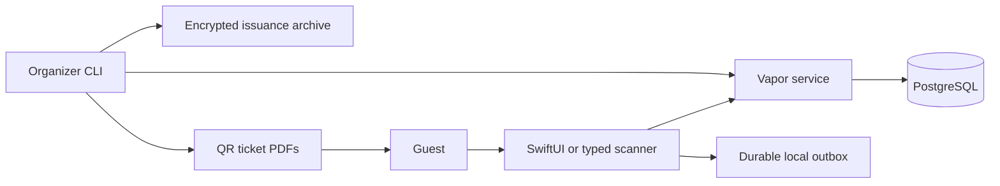

# GatePass

Standalone online admission for events with an existing CSV guest list. Import the roster, issue QR tickets, provision scoped staff scanners, and recover uncertain check-ins without creating a second admission record. Guests install nothing.

**Status:** organizer/server workflows pass against real PostgreSQL; the SwiftUI scanner compiles for iOS Simulator. Physical iPhone operation and live-event use remain unverified.

## Why it exists

Some organizers already collect registrations through a form or spreadsheet and need only admission at several doors. GatePass keeps that roster workflow and focuses on concurrent check-in and recovery. Existing event platforms already offer QR admission; simpler setup for an independent roster is the product hypothesis still to test.

## High-level architecture



The service is authoritative for ticket state, staff permissions, operation decisions and attendance. PostgreSQL arbitrates across service processes. Scanners persist requests before sending; a timeout means unknown, so they recover the same operation before accepting another scan. Admission requires connectivity.

## Admission and recovery design

1. **Issue durably:** parse CSV with quoted fields and preserved identifiers. Generate random ticket secrets, save an AES-GCM issuance archive, then atomically import ticket hashes and roster fields. Retrying the same batch replays the import; the archive regenerates the original PDFs.
2. **Persist before sending:** save the scan's operation UUID, event/device identity and request in a private outbox. Native startup loads recovery state before camera permission or manual actions can proceed.
3. **Decide transactionally:** lock the event and authorized staff row, acquire an operation-scoped advisory lock, and check for a previous decision. Identical operations replay; changed payloads return 409. Lock the ticket FOR UPDATE before admitting it.
4. **Commit together:** update the ticket, insert its unique admission and store the operation decision in one transaction. A deferred foreign key ties the admission to its operation. Distinct scans racing one ticket serialize on the ticket row.
5. **Resolve safely:** the client validates response identity and metadata, saves the result, then clears the pending request. Historical acceptance is marked for review and does not repeat a success haptic. Acknowledgment is persisted before scanning resumes.

The guarantee is one committed admission record per ticket, not exactly-once physical entry. Ticket screenshots are transferable bearer credentials: the first valid presentation wins.

### Source map and persistence

| Component | Responsibility |
| --- | --- |
| [GatePassProtocol](Sources/GatePassProtocol) | Ticket grammar, CSV, cryptography, atomic files, HTTP and durable outbox |
| [GatePassService](Sources/GatePassService) | Vapor routes, authorization, PostgreSQL schema and admission transactions |
| [GatePassServer](Sources/GatePassServer) | Service bootstrap and owner credential initialization |
| [GatePassAdmin](Sources/GatePassAdmin) | Organizer CLI, encrypted issuance, QR/PDF rendering and typed scanning |
| [GatePassScanner](ios/GatePassScanner) | SwiftUI camera, Keychain staff setup, manual lookup and recovery UI |

`events` and `staff_devices` scope authorization; `import_batches` makes issuance replayable; `tickets` holds hashed secrets and state; `scan_operations` stores immutable decisions; `admissions` has one row per ticket. Composite foreign keys keep references within an event. CHECK constraints require complete admission metadata.

Owner APIs manage events, imports, devices, revocation and attendance. Scanner APIs provide scans, manual scans, operation recovery, lookup and counts. Authorization is checked on server replay as well as new requests. See [routes and schema](Sources/GatePassService/Service.swift) and [client protocol](Sources/GatePassProtocol/Client.swift).

### Credential and transport boundaries

Ticket QRs contain event identity and a random secret, with no attendee name or email. The service stores secret hashes. Organizer archives and their separate encryption keys currently use private local files; native staff credentials use Keychain. Possessing both an archive and its key reveals its contents. Protect staff setup QR/JSON and ticket artifacts too.

Clients allow HTTP only on loopback; communication with an iPhone requires trusted HTTPS. The client rejects redirects and bounds streamed responses. No hosted deployment is included.

## Run locally

Requires macOS 14+, Swift 6.2+ and PostgreSQL server/client tools on PATH. The native scanner requires iOS 17+ and full Xcode; project generation uses XcodeGen.

```sh
swift build -j 4
sh scripts/dev-db.sh
.build/debug/GatePassServer serve --hostname 127.0.0.1 --port 8788
```

The development database uses loopback port 5433 and local trust authentication. Use database credentials and trusted HTTPS for deployment. The service creates its private owner credential at `.gatepass/owner.token` by default. `DATABASE_URL` and `GATEPASS_OWNER_TOKEN_FILE` override the defaults.

In another terminal, create an event and use its returned ID:

```sh
.build/debug/GatePassAdmin event-create --title Workshop
.build/debug/GatePassAdmin roster-import --event <event-id> --csv Fixtures/attendees.csv --dry-run
.build/debug/GatePassAdmin roster-import --event <event-id> --csv Fixtures/attendees.csv --archive .gatepass/workshop.gpenc --output .gatepass/tickets
.build/debug/GatePassAdmin device-create --event <event-id> --label EntranceA --device-file .gatepass/entrance-a.json
.build/debug/GatePassAdmin scan --device-file .gatepass/entrance-a.json --ticket @.gatepass/tickets/<ticket-id>.ticket --outbox .gatepass/scan.json
.build/debug/GatePassAdmin attendance-export --event <event-id> --output .gatepass/attendance.csv
```

Ticket IDs are listed in the generated distribution index. Recover an uncertain scan with `resume --device-file .gatepass/entrance-a.json --outbox .gatepass/scan.json`; preserve that outbox rather than creating another operation. `--help` lists issuance recovery, lookup, statistics, revocation and closure options.

For the native app, run `xcodegen generate --spec ios/GatePassScanner/project.yml` and open the generated project with scheme `GatePassScanner`. Provision staff setup against an HTTPS origin reachable by the iPhone; the Mac's loopback address is not that origin.

## Validation and reproduction

```sh
swift test -j 4
sh scripts/dev-db.sh
python3 scripts/e2e.py
python3 scripts/acceptance.py
```

Keep ports 8788/8789 free for the organizer E2E script. Tests use synthetic attendees and actual PostgreSQL; they do not clear shared database tables.

| Check | What actually passed |
| --- | --- |
| Swift unit tests | Eight cases: CSV edge cases, strict ticket parsing, archive tampering/wrong keys, formula-safe export, origin restrictions, response identity validation and failed result-write recovery |
| Organizer E2E | Actual CLI import/replay, encrypted archive recovery, QR PDF generation, staff provisioning, typed scans/outbox recovery, revocation, closure, punctuation in lookup and identifier-preserving export |
| Concurrency | 100 distinct operations across two real service processes produce one acceptance; 100 copies of one operation replay one decision and reject changed input |
| Database and crash checks | Partial admission metadata is rejected; pending outboxes recover committed decisions after restart; independent HTTP checks include SIGKILL recovery and event isolation |
| Native build | Generated Xcode project compiles for iOS Simulator under full Xcode; this is a build check, not a camera or UI runtime test |

CI repeats the server build, unit tests, real PostgreSQL workflows and independent HTTP checks, and separately compiles the scanner. [Verified implementation CI run](https://github.com/rohanshinde24/GatePass/actions/runs/45176833218).

## Limits and next steps

CSV input is capped at 2,000 attendees and 2 MiB. There is no offline admission, payment flow, public registration or wallet pass support. Production hosting, rate limiting and backup/restore rehearsal remain pending. Next checks are physical iPhone camera/Keychain/data protection behavior, signing/distribution, a venue rehearsal and an actual organizer pilot. No live-event or user-adoption result is claimed.
